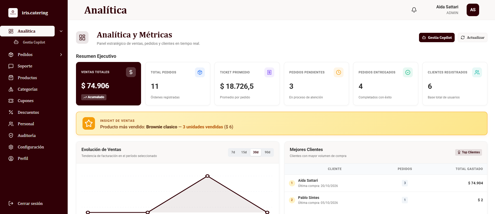
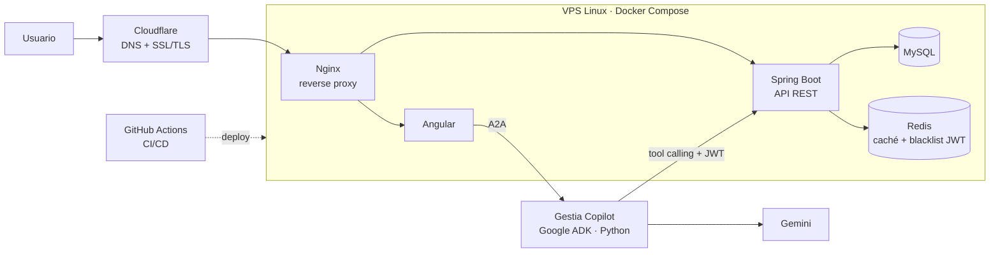
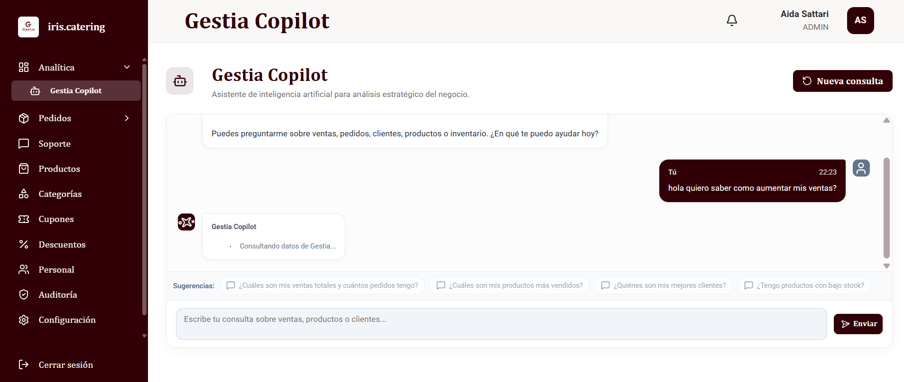
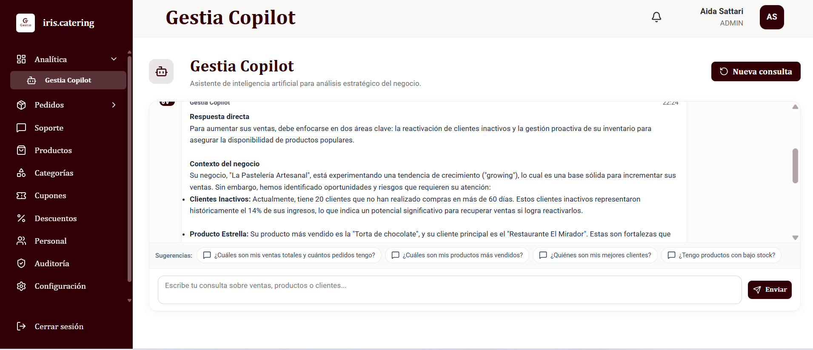
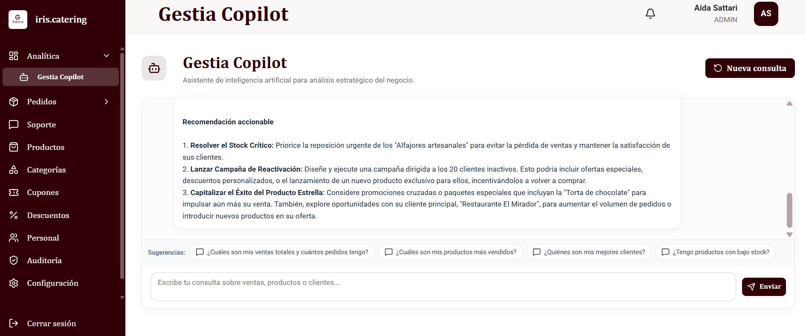
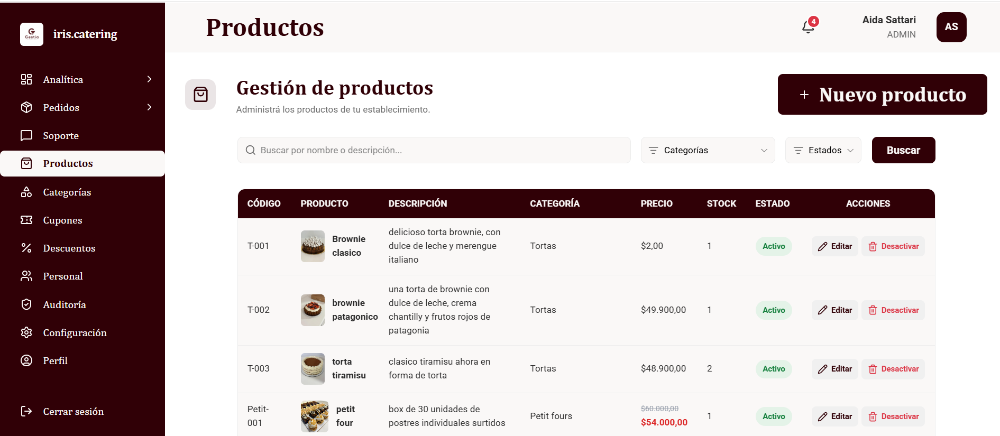
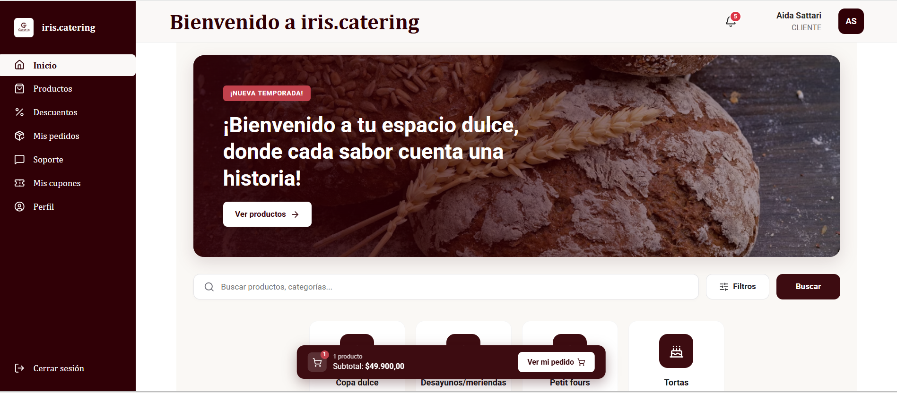
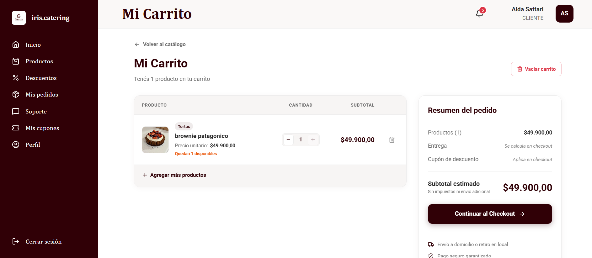

# Gestia — Caso de estudio

**Plataforma de gestión para negocios, en producción:** [gestiatech.com.ar](https://gestiatech.com.ar)

Gestia permite a comercios gestionar pedidos, productos, clientes, ventas e inventario, e incluye **Gestia Copilot**, un asistente de IA que responde preguntas de negocio sobre los datos reales del sistema.

> El código fuente es privado. Este repositorio documenta la arquitectura, las decisiones técnicas y el proceso de construcción.



---

## Mi rol

**Tech Lead & Backend / AI Developer** en un equipo de 3 personas, trabajando con metodología ágil.
Lideré el desarrollo backend, el deploy y el diseño e integración de Gestia Copilot.

Equipo: Aida Sattari · Lucía Pavón · Pablo Sintes

## Arquitectura



## Gestia en capturas

### Gestia Copilot: de la pregunta a la recomendación
El usuario pregunta en lenguaje natural; el Copilot consulta los datos reales del negocio y responde con contexto y recomendaciones accionables.





### Panel de administración


### Tienda para clientes



## Stack

| Capa | Tecnologías |
| --- | --- |
| Backend | Java, Spring Boot, Spring Security, JWT |
| Datos | MySQL, Redis |
| Frontend | Angular |
| IA | Python, Google Agent Development Kit (ADK), Gemini, A2A |
| Infraestructura | VPS Linux, Docker Compose, Nginx, Cloudflare |
| CI/CD | GitHub Actions |

## Decisiones técnicas

### 1. Logout real con JWT: blacklist en Redis
**Problema:** al cerrar sesión, el JWT seguía siendo válido hasta expirar.
**Solución:** al hacer logout, el token se guarda en Redis y el filtro de seguridad lo rechaza antes de permitir el acceso.
**Aprendizaje:** Redis terminó cumpliendo dos roles distintos en el sistema: rendimiento (caché) y seguridad (blacklist).

### 2. Caché de productos con invalidación
**Problema:** consultas repetidas a la base de datos para datos que cambian poco.
**Solución:** caché de productos en Redis, invalidada al crear, editar o desactivar un producto (`@CacheEvict`).

### 3. Pasarela de pagos desacoplada
**Problema:** integrar Mercado Pago directo en la lógica de pagos ata el negocio a un proveedor y complica los tests.
**Solución:** la lógica trabaja contra una interfaz y Mercado Pago es solo una implementación.

```java
public interface PasarelaPagosService {
    PasarelaPagoResponse crearPago(Pago pago);
    boolean verificarPago(String referencia);
    boolean reembolsarPago(Pago pago);
}
```

**Resultado:** tests sin depender de una API externa y posibilidad de cambiar de proveedor sin tocar el negocio.

### 4. Almacenamiento de imágenes intercambiable
**Problema:** las imágenes se guardaban en disco local, pero el sistema tenía que poder crecer.
**Solución:** una abstracción de almacenamiento. Hoy es local; mañana puede ser S3 o Cloudflare R2 sin modificar el módulo de Productos.

### 5. IA que no inventa datos: Gestia Copilot
**Problema:** un asistente de IA útil para un negocio no puede inventar cifras.
**Solución:** un sistema multiagente con Google ADK que enruta cada consulta a agentes especializados, los cuales obtienen la información llamando a las APIs existentes de Gestia, con la autenticación JWT del usuario. Gemini razona solo sobre esos datos.
**Resultado:** responde sobre ventas, pedidos, stock y clientes, y genera recomendaciones (bajo stock, productos más vendidos, ingresos).

Más detalle: [gestia-ai-business-assistant](https://github.com/str-aida/gestia-ai-business-assistant)

### 6. Deploy reproducible
Todo el sistema corre con **Docker Compose** en un VPS Linux, con **Nginx** como reverse proxy, **Cloudflare** para DNS y SSL/TLS, y deploy automatizado con **GitHub Actions**.

## Documentación relacionada

- [Análisis funcional y QA](https://github.com/str-aida/gestia-analisis-funcional): requerimientos, UML, APIs, casos de prueba y riesgos.

## Contacto

**Aida Sattari** · [LinkedIn](https://www.linkedin.com/in/aida-sattari-str) · aida.sattari@gmail.com
